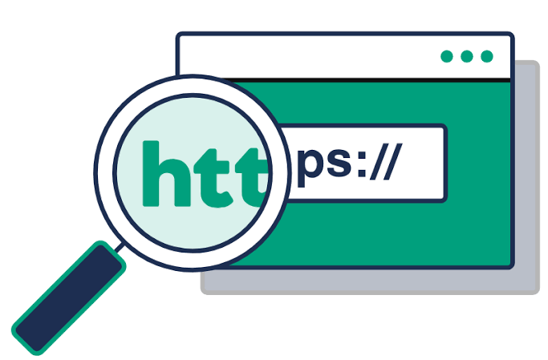
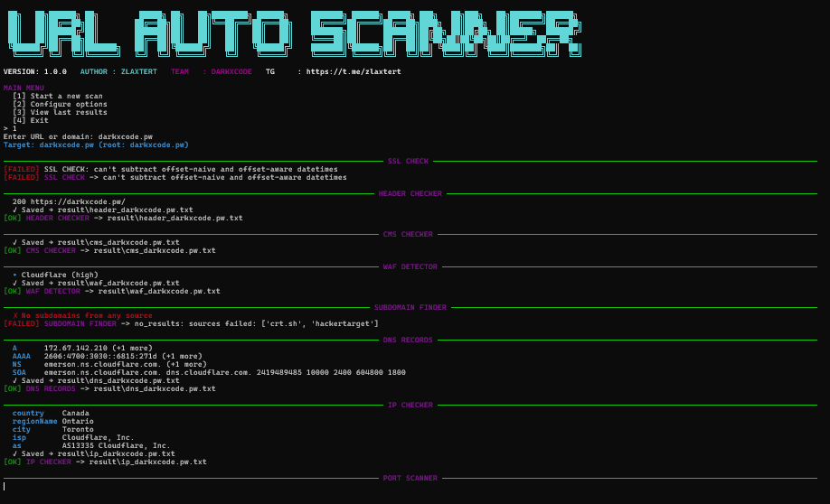

# URL-AUTO-SCANNER
URL Auto Scanner is a modular recon tool that runs one target through 10 automated modules in a fixed order: SSL/TLS cert check, security header audit, CMS + framework detection, WAF fingerprinting, passive subdomain enumeration, DNS records, IP geolocation, threaded port scanning, and reverse IP lookup. Each module saves its own report file. CLI + interactive TUI, no API keys required.

<h1 align="center">
   
  
   
  URL AUTO SCANNER
   
</h1>

  
  

 • <a href="https://instagram.com/darkxcode_">Contact</a> •
  <a href="https://darkxcode.site/">Other Tools</a> •

## Output

This is the result if the code is successfully validation.

---

> **NOTE**
> Warning All the information provided here is intended solely for educational and testing purposes.
> I do not endorse any illegal activities or unfair usage of this program.
